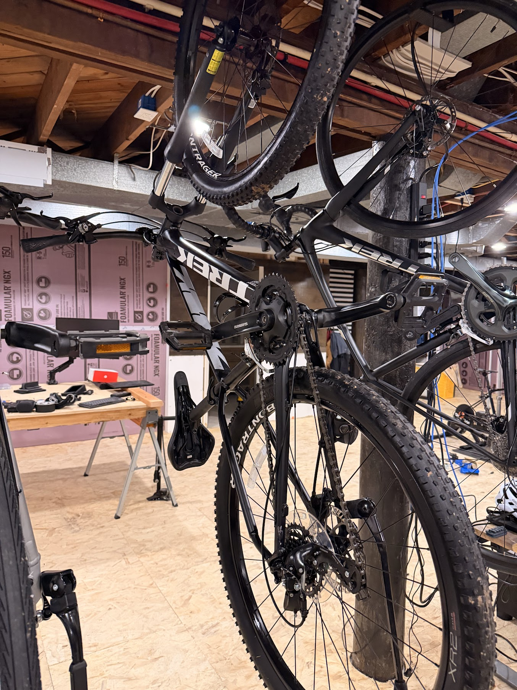
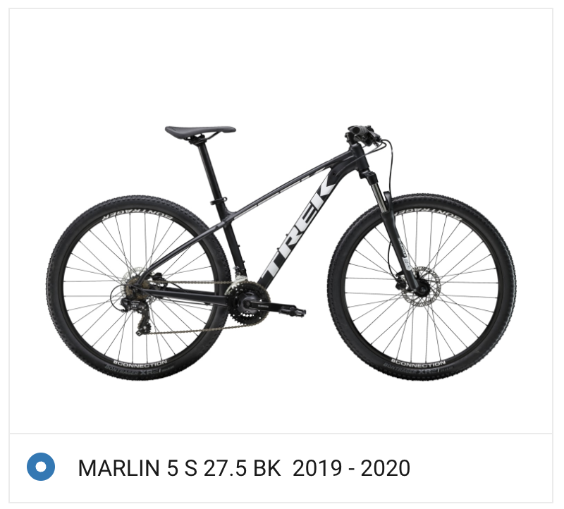

# trek marlin 5

# Todo
* [ ] current gears are annoying
  * Proposed upgrade: Shimano Deore 1x11, 11–51T cassette. Amazon links below are model-specific searches, not verified seller listings.
  * https://www.performancebike.com/shimano-deore-xt-m8100-mountain-bike-mini-groupset-black-1-x-12-speed-shimanodeorextgrp3-bdl/p1585800
  * [ ] Rear derailleur: Shimano Deore RD-M5100-SGS, 11-speed, clutch — [Amazon search](https://www.amazon.com/s?k=Shimano+RD-M5100-SGS)
  * [ ] Right shifter: Shimano SL-M5100-R, 11-speed, clamp-band version (not I-SPEC) — [Amazon search](https://www.amazon.com/s?k=Shimano+SL-M5100-R+11+speed+clamp)
  * [ ] Cassette: Shimano CS-M5100-11, **11–51T** — [Amazon search](https://www.amazon.com/s?k=Shimano+CS-M5100-11+11-51T)
  * [ ] Crankset with chainring: Shimano FC-M5100-1, proposed 170 mm arms / 30T ring for easier climbing; 32T is the alternative for more top-end speed — [Amazon search](https://www.amazon.com/s?k=Shimano+FC-M5100-1+170mm+30T)
  * [ ] Bottom bracket: Shimano BB-MT501, BSA threaded 68/73 mm, for the frame's 73 mm shell — [Amazon search](https://www.amazon.com/s?k=Shimano+BB-MT501+68+73)
  * [ ] Chain: Shimano CN-HG601-11, long enough for the 11–51T setup and cut to fit; include an SM-CN900-11 quick link if not supplied — [chain](https://www.amazon.com/s?k=Shimano+CN-HG601-11+126+links), [quick link](https://www.amazon.com/s?k=Shimano+SM-CN900-11)
  * [ ] Shift cable and housing kit: Shimano OT-SP41-compatible housing, inner cable, ferrules and cable end cap; avoid duplicating the inner cable if supplied with the shifter — [Amazon search](https://www.amazon.com/s?k=Shimano+OT-SP41+shift+cable+housing+kit)
  * [ ] Replacement rear wheel: 135 mm quick release, full-length HG freehub. Preferred: Quality Wheels Deore M610 / DT Swiss 533d, about $155 — [27.5-inch WE2758](https://www.performancebike.com/quality-wheels-deore-m610-dt-533d-rear-disc-wheel-black-we2758/p1345974?v=861292), [29-inch WE2762](https://www.treefortbikes.com/Quality-Wheels-Mountain-Disc-Rear-Wheel-DT-533d-Deore). Match the existing tire diameter before ordering; the saved screenshot says S / 27.5. Keep the front wheel.
  * [ ] If choosing the Center Lock DT wheel: matching-diameter Center Lock rear rotor and lockring, e.g. Shimano SM-RT54 for stock resin pads — [Amazon search](https://www.amazon.com/s?k=Shimano+SM-RT54+rotor+lockring). Not needed with a six-bolt replacement wheel that reuses the existing rotor.
  * [ ] For the new Presta-drilled rim: correctly sized Presta inner tube and rim tape if not included. Keep the existing tire with a tube for now — [Amazon search](https://www.amazon.com/s?k=Schwalbe+Presta+mountain+bike+inner+tube)
* [ ] headset play
* [ ] dropper post
* [ ] new tires
* [ ] better shocks (https://www.reddit.com/r/trekmarlin/comments/xibjs2/120mm_rockshox_recon_fork_is_awesome/)

# Background

* Serial number: `WTU075JC0529P`
* Bought from some guy off marketplace for $420 (nice)
  

Specs: https://www.trekbikes.com/us/en_US/bikes/mountain-bikes/cross-country-mountain-bikes/marlin/marlin-5/a/23134/
